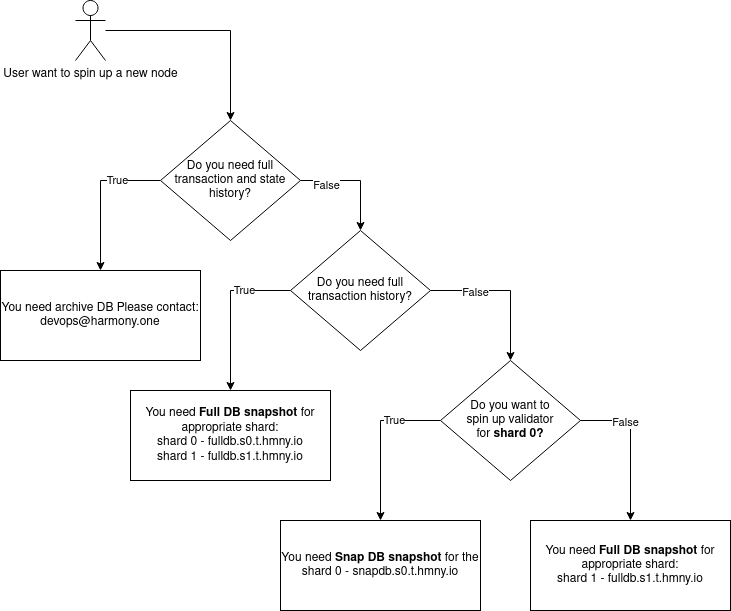

# 3. Syncing DB

## Simple algorithm to distinguish between snapshot types

Using answers for these questions you can easily understand which snapshot type you will need

<figure><figcaption></figcaption></figure>

## Validator Nodes


This document introduces another centralized fast state syncing method using rclone. Please use it with caution. This guide is mainly used for a newly started node to catch up with the blockchain faster. Otherwise, the blockchain syncing may take weeks from genesis block.



Rclone db snapshot is synced with blockchain frequently. However, there maybe a potential race condition when the rclone may fail due to our nodes were updating the db files at the same time. In this case, just re-run the rclone command to re-sync again.


### 1. Installing Rclone

For installing Rclone, please follow the instructions at [https://rclone.org](https://rclone.org/).

**TL;DR:** on a Linux system, you may run the following command:

```bash
curl https://rclone.org/install.sh | sudo bash
```


Make sure your rclone version is above **v1.53.2** . you can check version by `rclone version`


### 2. Configuring Rclone

To check the location of the `rclone.conf`file run:

```bash
rclone config file
```

The `rclone.conf` file is usually located at `~/.config/rclone/rclone.conf` .

Now run the following command to create the rclone.conf file:

```bash
cat<<-EOF > ~/.config/rclone/rclone.conf
[snap]
type = webdav
vendor = other
user = snap
pass = ufbTDtK0fENuutwuDOHae57xT8URsZVIcdotK30T5A
EOF
```

### 2.1 BEWARE: Understanding the \`rclone sync\`


The most important parts in bold:

Sync the source to the destination, **changing the destination only**. Doesn't transfer files that are identical on source and destination, testing by size and modification time or MD5SUM. **Destination is updated to match source, including deleting files if necessary** (except duplicate objects). [Link to the full rclone documentation](https://rclone.org/commands/rclone_sync/).

`sync` command was chosen because you need to have your blockchain data folder to be identical with the snapshot data


**As user you need to carefully get the full path to the folder and as destination. If you have some important data in the destination, please move it somewhere else.**&#x20;


Usually data dir folder is \``` ./` `` which means folder in which harmony is running

You can double check this via:

`ls -l | grep 'harmony_db_'`

`Expected result id is name with shard number on the end, e.x. harmony_db_0.`


Q: How to get the full path to the your blockchain data folder if it isn't **default**?

1. Check how do you start harmony via `ps -ef | grep harmony`  and check for the `--datadir` option, if you don't have it go to the following step, else to the 3rd
2. Check the harmony.conf for DataDir option or check your `grep DataDir harmony.conf`
3. Go to the folder from the cmd option if have it or to folder from config if you don't have cmd option, do the following:

```bash
cd your_data_dir # folder from the cmd line or config
ls -l # it will give the shard folder name like harmony_db_0/
pwd # now you have full path to your data dir
```

### 3. Shard 0 validator - Snap DB sync


SnapDB is a type of DB that contain a snapshot of the state at a given block. It doesn't have any **block history** and **hence not suitable for RPC node.**


Below is the command to sync the Snap DB for the shard 0. It is around 130+ Gb as of Aug 2026:


**Important**: Since this can cause data loss, test first with the `--dry-run` or the `--interactive`/`-i` flag.


```bash
YOUR_DATA_DIR='./' # This is the default installation, change it if you use something else

nohup rclone -P -L \
  --webdav-url 'http://snapdb.s0.t.hmny.io/webdav' \
  --checksum sync \
  snap: "${YOUR_DATA_DIR}harmony_db_0" \
  --multi-thread-streams 8 \
  --transfers=256 \
  --checkers=256 \
  --fast-list \
  --verbose \
  >> ~/rclone.log 2>&1 &
  
# u can use the following commands to monitor progress
taif -f ~/rclone.log # last log entries
pgrep -af rclone # rclone is still running
```

Small explanation for flags used to save your time with rclone manual: &#x20;

```bash
nohup - keep rclone running after you disconnect from SSH
--webdav-url - WebDAV source address
YOUR_DATA_DIR/harmony_db_0 - local destination path
-P - show live progress, transfer speed and ETA
-L - follow symlinks
--checksum - compare files by checksum and size instead of modification time
snap: - rclone remote name from rclone.conf
--multi-thread-streams=8 - use up to 8 streams for a single large file
--transfers=256 - transfer up to 256 files in parallel
--checkers=256 - compare up to 256 files in parallel
--fast-list - speed up listing for very large directories by keeping more of the remote file tree in memory
--verbose - show detailed transfer information
sync - make the destination match the source exactly; matching files are skipped, missing or changed files are transferred, and destination-only files are deleted
>> ~/rclone.log - append command output to a log file in the current user home directory
2>&1 - redirect stderr to the same log file as stdout
& - run the command in the background
Important: sync can delete files from the destination if they do not exist on the source
```

### 4. Full db sync for appropriate shard &#x20;


Since v4.3.12 shard 1 doesn't need to download anymore shard 0 DB. Instead, the node will download automatically the blocks required for the node in shard 1 to work.


### 4.1 Fast download for Shard0 RPC Explorer node (non archival), use if you have fast(>1Gb/s) network interface


**Important**: Since this can cause data loss, test first with the `--dry-run` or the `--interactive`/`-i` flag.


```bash
YOUR_DATA_DIR='./' # This is the default installation, change it if you use something else

nohup rclone -P -L \
  --webdav-url 'http://fulldb-fast.s0.t.hmny.io/webdav' \
  --checksum sync \
  snap: "${YOUR_DATA_DIR}harmony_db_0" \
  --multi-thread-streams 8 \
  --transfers=256 \
  --checkers=256 \
  --fast-list \
  --verbose \
  >> ~/rclone.log 2>&1 &

# u can use the following commands to monitor progress
taif -f ~/rclone.log # last log entries
pgrep -af rclone # rclone is still running
```

### 4.2 Shard0 RPC Explorer node (non archival)


**Important**: Since this can cause data loss, test first with the `--dry-run` or the `--interactive`/`-i` flag.


```bash
YOUR_DATA_DIR='./' # This is the default installation, change it if you use something else

nohup rclone -P -L \
  --webdav-url 'http://fulldb.s0.t.hmny.io/webdav' \
  --checksum sync \
  snap: "${YOUR_DATA_DIR}harmony_db_0" \
  --multi-thread-streams 4 \
  --transfers=32 \
  --checkers=64 \
  --fast-list \
  --verbose \
  >> ~/rclone.log 2>&1 &

# You can use the following commands to monitor progress
tail -f ~/rclone.log # show the latest log entries
pgrep -af rclone     # check that rclone is still running
```

### 4.3 Shard 1 validator


If you need to spin up RPC as soon as possible you can use Harmony node with faster network interface and do rlcone faster



**Important**: Since this can cause data loss, test first with the `--dry-run` or the `--interactive`/`-i` flag.


```bash
YOUR_DATA_DIR='./' # This is the default installation, change it if you use something else

nohup rclone -P -L \
  --webdav-url 'http://fulldb.s1.t.hmny.io/webdav' \
  --checksum sync \
  snap: "${YOUR_DATA_DIR}harmony_db_1" \
  --multi-thread-streams 4 \
  --transfers=32 \
  --checkers=64 \
  --fast-list \
  --verbose \
  >> ~/rclone.log 2>&1 &

# You can use the following commands to monitor progress
tail -f ~/rclone.log # show the latest log entries
pgrep -af rclone     # check that rclone is still running
```

### Archival snapshot for the Non-Validating/Explorer Nodes <a href="#archival-snapshot-for-the-non-validating-explorer-nodes" id="archival-snapshot-for-the-non-validating-explorer-nodes"></a>


**As of 1st August 2026, the size for the shard 0 on mainnet is \~24TiB.**&#x20;



Please contact us at [devops@harmony.one](mailto:devops@harmony.one) if you need to access our archival db and we will do it as soon as possible. \
We have done it before multiple times with either rclone or rsync.


### 5. Testnet snapshots <a href="#archival-snapshot-for-the-non-validating-explorer-nodes" id="archival-snapshot-for-the-non-validating-explorer-nodes"></a>

If you want to quickly test your validator/RPC setup via the testnet network, please use the setup from [#id-2.-configuring-rclone](syncing-db.md#id-2.-configuring-rclone "mention")and the info below.

### 5.1 Testnet shard 0


**Important**: Since this can cause data loss, test first with the `--dry-run` or the `--interactive`/`-i` flag.


```bash
YOUR_DATA_DIR='./' # This is the default installation, change it if you use something else

nohup rclone -P -L \
  --webdav-url 'http://fulldb.s0.b.hmny.io/webdav' \
  --checksum sync \
  snap: "${YOUR_DATA_DIR}harmony_db_0" \
  --multi-thread-streams 4 \
  --transfers=32 \
  --checkers=64 \
  --fast-list \
  --verbose \
  >> ~/rclone.log 2>&1 &

# You can use the following commands to monitor progress
tail -f ~/rclone.log # show the latest log entries
pgrep -af rclone     # check that rclone is still running
```

### 5.2 Testnet shard 1


**Important**: Since this can cause data loss, test first with the `--dry-run` or the `--interactive`/`-i` flag.


```bash
YOUR_DATA_DIR='./' # This is the default installation, change it if you use something else

nohup rclone -P -L \
  --webdav-url 'http://fulldb.s1.b.hmny.io/webdav' \
  --checksum sync \
  snap: "${YOUR_DATA_DIR}harmony_db_1" \
  --multi-thread-streams 4 \
  --transfers=32 \
  --checkers=64 \
  --fast-list \
  --verbose \
  >> ~/rclone.log 2>&1 &

# You can use the following commands to monitor progress
tail -f ~/rclone.log # show the latest log entries
pgrep -af rclone     # check that rclone is still running
```
